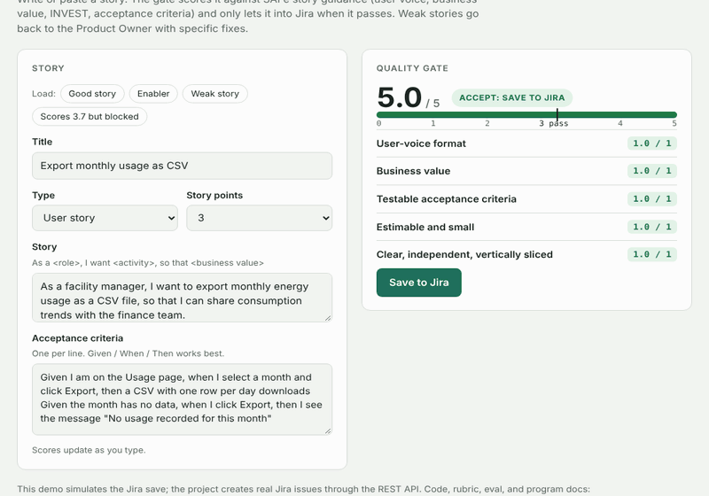

# ✅ SAFe Story Quality Gate

**Scores user stories 0–5 against SAFe 6.0 story guidance and saves them to Jira Software only when they pass: a score of 3.0 or higher *and* at least one testable acceptance criterion. Weak stories go back to the Product Owner with specific fixes.**

> 📌 **Portfolio note:** This project improves backlog quality on an Agile Release Train. It's built and run as a program: a rubric grounded in SAFe, a deterministic gate with an explicit P0 metric, a Jira integration with a safe dry-run mode, and an eval that changed the design. The `docs/` folder is as important as the code.



**🔗 Try it in your browser:** [nathanmyth.github.io/story-quality-gate/demo](https://nathanmyth.github.io/story-quality-gate/demo/) (Jira save simulated)

---

## The problem

Stories reach PI Planning and iteration planning without acceptance criteria, without a clear "so that", or sized like features. Teams can't estimate them, "done" is never defined, and work spills into the next iteration, which hurts the ART's predictability.

## How the gate works

| # | Criterion (1 point each) | SAFe basis |
|---|---|---|
| 1 | **User-voice format**: As a… I want… so that… (enablers: type stated) | Role, activity, business value |
| 2 | **Business value**: a real outcome, not a restated activity | INVEST *Valuable* |
| 3 | **Testable acceptance criteria**: Given / When / Then or measurable, no vague terms | INVEST *Testable*; 3 Cs *Confirmation* |
| 4 | **Estimable and small**: 1, 2, 3, 5, 8 points (13 = partial) | INVEST *Estimable*, *Small*; fits one iteration |
| 5 | **Clear, independent, vertical**: one goal, user-visible slice | INVEST *Independent*, *Valuable* |

**Saved to Jira only if:** score ≥ **3.0** **and** at least one acceptance criterion is testable. Full mapping: [SAFe rubric](docs/02-safe-rubric.md).

When a story passes, the gate creates a **Story** in Jira through the REST API (v3), with the acceptance criteria and gate score in the description and labels `quality-gate` and `qg-score-N`. Without Jira credentials it runs in **dry-run mode** and writes the exact request to a local outbox.

## Results

Evaluated against 18 stories labeled accept/reject by Product Owner judgment:

| Metric | Target | Result |
|---|---|---|
| **False accepts** (weak story saved to Jira) | **0%** | 0% |
| Agreement with PO labels | ≥ 90% | 100% |
| False rejects (good story blocked) | ≤ 10% | 0% |

**What the eval changed:** with a score threshold alone, a story whose only criterion was "Notifications work well" would **pass at 3.9** with a 3-point estimate, and "Dashboard for sales" scored **4.0** with no acceptance criteria. So the hard rule became "at least one **testable** criterion", not just "has criteria" ([ADR-003](docs/decisions/ADR-003-threshold-and-hard-rule.md)).

**Known limitation:** the labels and rubric were written by the same person, so 100% is optimistic. Milestone M3 calibrates against real stories labeled blind by 2–3 POs.

## Design decisions

| ADR | Decision |
|---|---|
| [ADR-001](docs/decisions/ADR-001-deterministic-scoring.md) | Deterministic rubric scoring. A gate into the system of record must give the same score every time and explain every lost point |
| [ADR-002](docs/decisions/ADR-002-ai-coach-never-scores.md) | The AI coach suggests rewrites but never changes a score; the PO resubmits through the gate |
| [ADR-003](docs/decisions/ADR-003-threshold-and-hard-rule.md) | Pass at 3.0 plus a testable-acceptance-criteria hard rule, based on eval findings |

## Program artifacts

[PRD](docs/01-prd.md) · [SAFe rubric](docs/02-safe-rubric.md) · [Architecture](docs/03-architecture.md) · [Milestones (iteration / PI aligned)](docs/04-milestones.md) · [Risk register](docs/05-risk-register.md) · [Launch checklist](docs/06-launch-checklist.md) · [Retrospective](docs/07-retro.md) · [Rubric config](rubric/rubric.json)

## Quick start

```bash
git clone https://github.com/nathanmyth/story-quality-gate.git
cd story-quality-gate
python -m venv .venv && source .venv/bin/activate     # Windows: .venv\Scripts\Activate.ps1
pip install -r requirements.txt

python -m src.cli examples/good_story.txt      # passes → saved (dry run)
python -m src.cli examples/weak_story.txt      # fails → feedback, not saved
python -m eval.run_eval                        # gate vs. PO labels
pytest
streamlit run app.py                           # web UI
```

### Connect to Jira Software (Cloud)

1. Create an API token at **id.atlassian.com → Security → API tokens**. A service account with access to one project is best.
2. Copy `.env.example` to `.env` and fill in `JIRA_BASE_URL`, `JIRA_EMAIL`, `JIRA_API_TOKEN`, and `JIRA_PROJECT_KEY`.
3. Optional: set `JIRA_STORY_POINTS_FIELD` to your site's story points field ID so estimates are saved too.
4. Run `python -m src.cli examples/good_story.txt`. The output prints the new issue key and link.

### Story text format

```
Title: Export monthly usage as CSV
Type: user                      # or: enabler - compliance
As a facility manager, I want to export monthly energy usage as a CSV file,
so that I can share consumption trends with the finance team.
Acceptance criteria:
- Given I am on the Usage page, when I select a month and click Export, then a CSV downloads
Story points: 3
```

## Project structure

```
├── rubric/rubric.json      # SAFe rubric: criteria, threshold, term lists (versioned)
├── src/
│   ├── story.py            # parse text or JSON into a story
│   ├── scorer.py           # deterministic 0–5 scoring + hard rule
│   ├── gate.py             # score → save to Jira only if passing → log decision
│   ├── jira_client.py      # Jira Cloud REST API v3 (ADF description), dry-run outbox
│   ├── coach.py            # optional AI rewrite suggestions (never scores)
│   └── cli.py
├── app.py                  # Streamlit UI
├── demo/index.html         # browser demo (GitHub Pages)
├── examples/               # good, weak, and enabler stories
├── eval/                   # 18 PO-labeled stories + harness
├── tests/
└── docs/                   # program artifacts
```

## Sources

- [SAFe User Story Primer](https://v3.scaledagileframework.com/wp-content/uploads/delightful-downloads/2021/07/User-Story-Primer-1.pdf): user voice, 3 Cs, INVEST, acceptance criteria, splitting
- [SAFe: Story](https://framework.scaledagile.com/story): stories as small units of work that fit within an iteration; enabler work types

SAFe and Scaled Agile Framework are trademarks of Scaled Agile, Inc. This project is independent and not affiliated with Scaled Agile or Atlassian.

## About me

Built by **Senthilnathan Abboy Selvaraj**, AI Technical Program Manager. [LinkedIn](https://www.linkedin.com/in/senthilnathanas) · [More projects](https://github.com/nathanmyth)
